<div align="center">

<picture>
  <source media="(prefers-color-scheme: dark)" srcset="docs/assets/logo-wordmark-dark.png">
  
</picture>

### Group trip planning that ends in a plan everyone agreed to.

Meridian learns what each traveler wants, shows the group where it agrees and where it doesn't,<br>
suggests places locals actually go, and drafts an itinerary the group votes on before it's locked.


[**Features**](#features) · [**How it works**](#how-it-works) · [**Try it**](#try-it-in-five-minutes) · [**AI that shows its work**](#ai-that-shows-its-work) · [**Architecture**](#architecture)

<br>

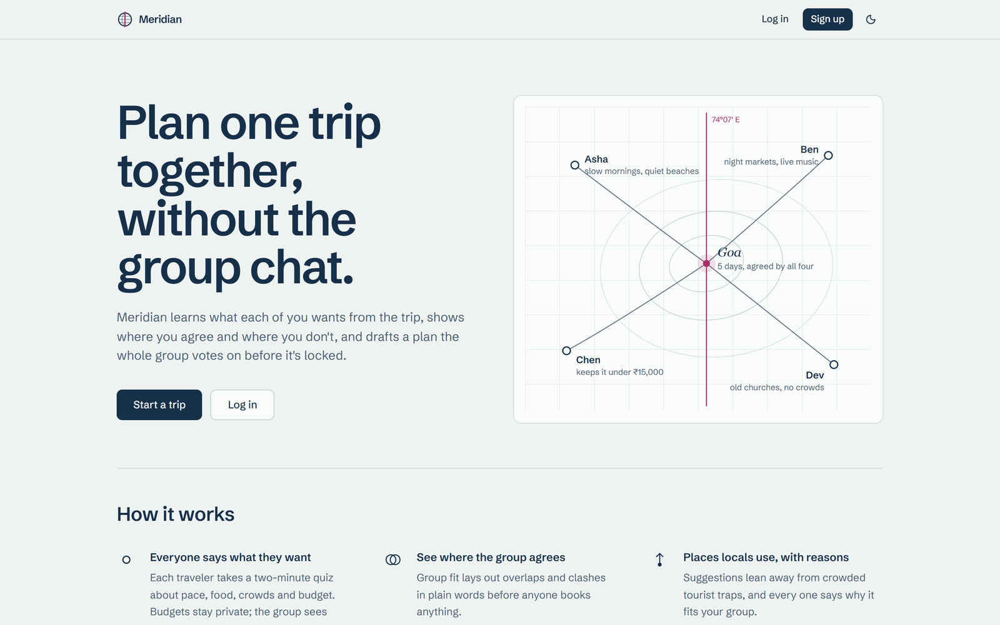

</div>

---

## Why Meridian

Planning a trip with friends usually means one person chasing replies across chats and tabs, then booking a package that fits nobody in particular. The places that come up first are the crowded ones, often because someone paid for them to.

Meridian puts the whole group in one shared trip space instead:

| The usual way | With Meridian |
|---|---|
| One organizer chases everyone for opinions | Everyone records their own preferences once, and the app shows who hasn't yet |
| Rigid, one-size-fits-all packages | A day-by-day plan drafted from *this* group's places, pace and budget |
| Lists of crowded tourist traps | Suggestions that lean toward places locals use, with a hidden-gems ↔ classics slider |
| Rankings shaped by paid placement | No commercial signal in ranking, ever; anything sponsored is labelled |
| "I thought we agreed…" | Votes, a quorum, and a decision log that records who chose what and why |

## Our promises

These rules are enforced in code, not just written down:

- **Consensus before lock.** The itinerary can only be locked once enough of the group approves the current plan. An organizer override needs a written reason, and that reason is logged.
- **Every vote weighs the same.** The app always shows who hasn't voted or filled in their preferences yet.
- **No paid placement.** Ranking uses fit and crowd signals only. A "Sponsored" label appears whenever an option is marked as one.
- **Every price shows its source and when it was checked.** Prices older than 24 hours are flagged as stale.
- **You book, not us.** Every option links out to its provider. Meridian never books or takes payment.
- **Every AI output explains itself.** It carries an **AI** badge, a "Why?" popover, and controls to regenerate or dismiss it.
- **Private budgets stay private.** The group sees only the shared range, never what each person can spend.

## How it works

1. **Start a trip and invite the group.** Name it, pick the destination and dates, and share the invite link.
2. **Everyone takes a two-minute quiz.** A few sliders plus "describe your ideal trip" become a travel-style profile. Each traveler can see and edit every field.
3. **See where the group stands.** Group fit lays out agreements, trade-offs and conflicts in plain language, before anyone books anything.
4. **Build the shortlist.** Add places from OpenStreetMap, paste a link or drop a pin, or accept a suggestion. Each one says who added it and why.
5. **Get a draft itinerary.** Days are grouped by area at the group's pace, with travel time between stops.
6. **Decide together.** Members propose changes and vote on them live. Once the group approves the plan, it locks, and the decision log records how you got there.

## Features

### Group fit: the whole group at a glance

A members × preferences matrix shows pace, interests, budgets, crowd tolerance, must-haves and dealbreakers side by side. Each row is marked as agreed, trade-off or conflict with an icon and a word, not just a color. The AI turns the numbers into trade-offs you can talk through, each with a compromise to start from. Every place on the shortlist gets a group-fit score that says who it suits and who it doesn't.

<p align="center">
  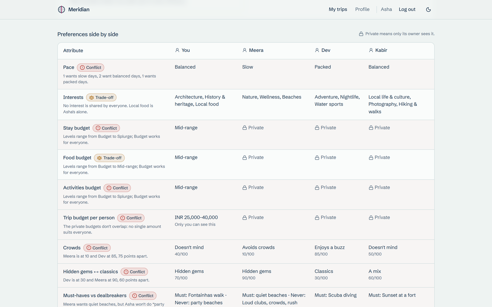
  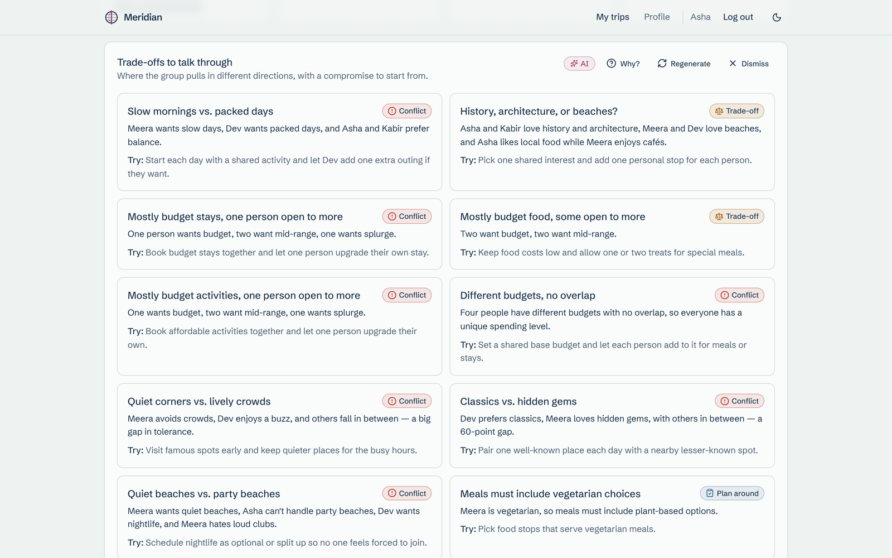
</p>

### Suggestions locals would make

Candidates come from OpenStreetMap around your destination and are ranked for the whole group. A **hidden gems ↔ classics** slider and an **avoid crowds** toggle push famous spots down when you want them out of the way. Each card says, in one sentence, why the place fits *your* group, plus its source, distance and tags.

### A shared shortlist, on a map

Add places by search, pasted link or map pin. Each item shows who added it and their reason. Members react with **love / ok / no way**, and you can filter by category, by who added it, or by group-fit score.

<p align="center">
  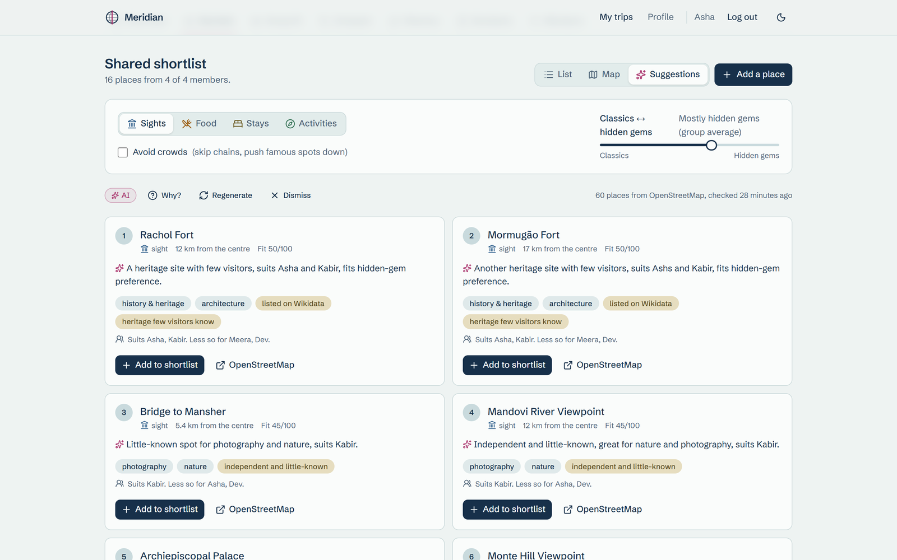
  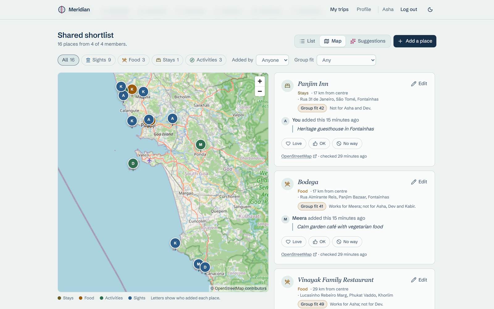
</p>

### A draft itinerary that actually works on the ground

Places are grouped into days by area, scheduled at the group's median pace, with realistic travel time between stops and meals at mealtimes. The AI orders and times one day at a time, and code checks every answer. Each day's "Why?" lists any fixes, and a route map shows each day's stops.

### Change it together, live

Members propose a move, swap, add or removal with a reason. Everyone votes, and the result updates in every open window. A change applies on its own the moment it has enough approvals and is dropped the moment it can't get them. Anyone can comment on any stop or proposal.

<p align="center">
  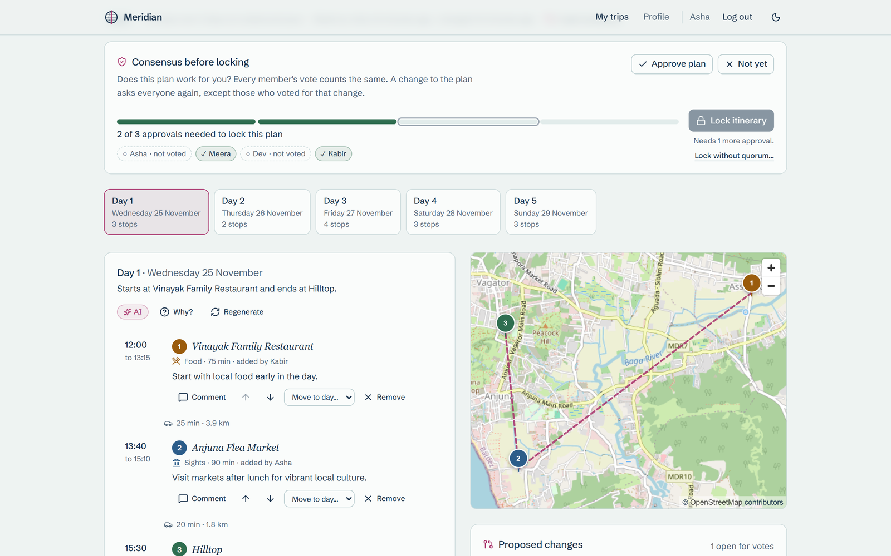
  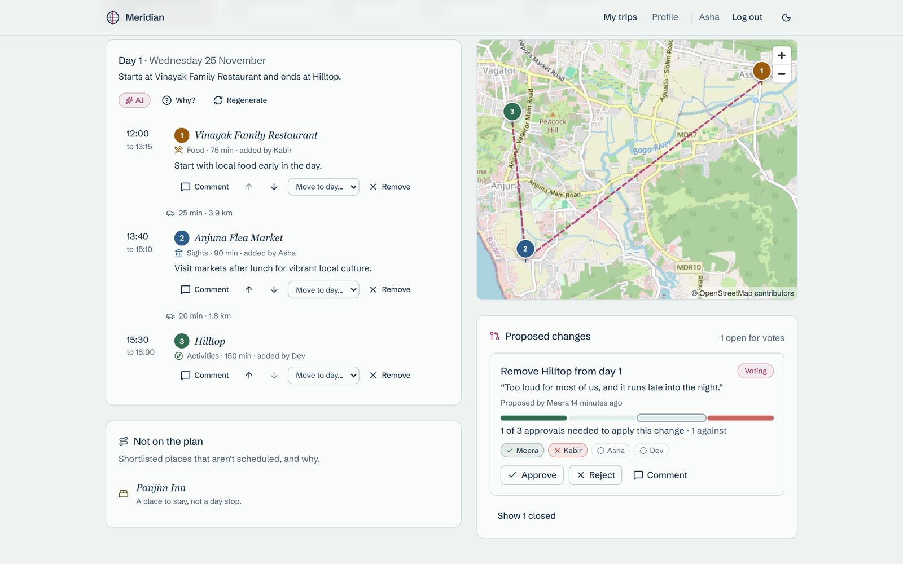
</p>

### Lock it, and remember why

The consensus gate shows exactly how many approvals the plan has and who hasn't voted. **Lock itinerary** opens only at quorum, and the organizer sets the quorum (a majority by default). Every decision goes into an append-only log with the alternatives, each vote, the reason given and a short AI summary. Each stop on the plan links to the decision that put it there.

<p align="center">
  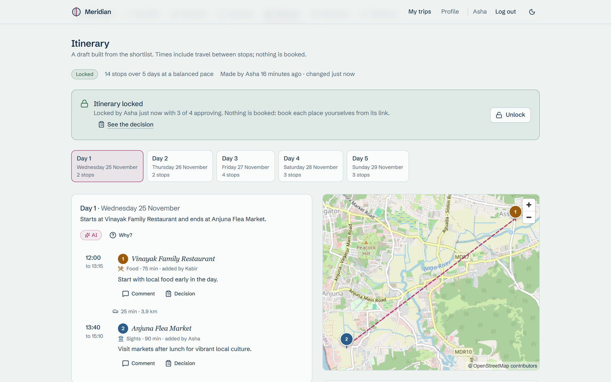
  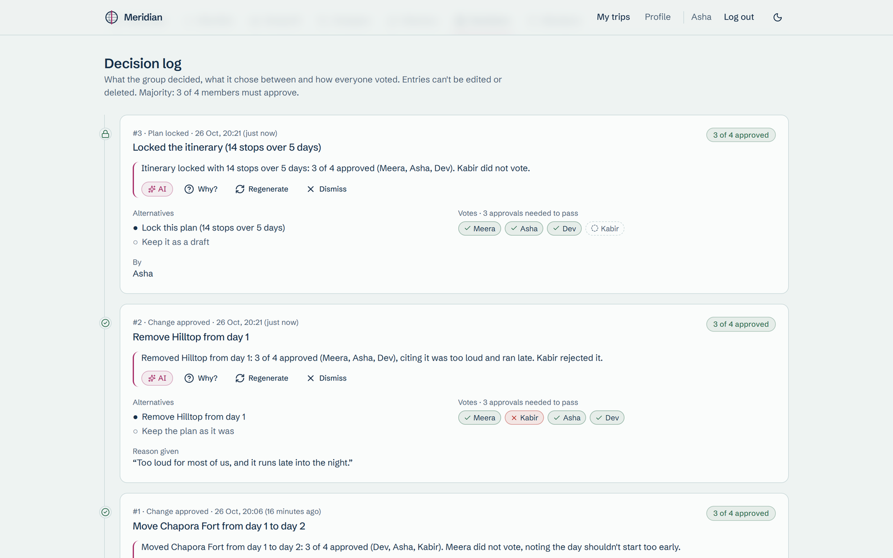
</p>

### Compare prices honestly

Line up stays, flights or activities side by side with provider, price, currency, **when the price was checked** and a source link. Stale prices are flagged, the cheapest is marked, and "Open on provider" takes you to book it yourself.

<p align="center">
  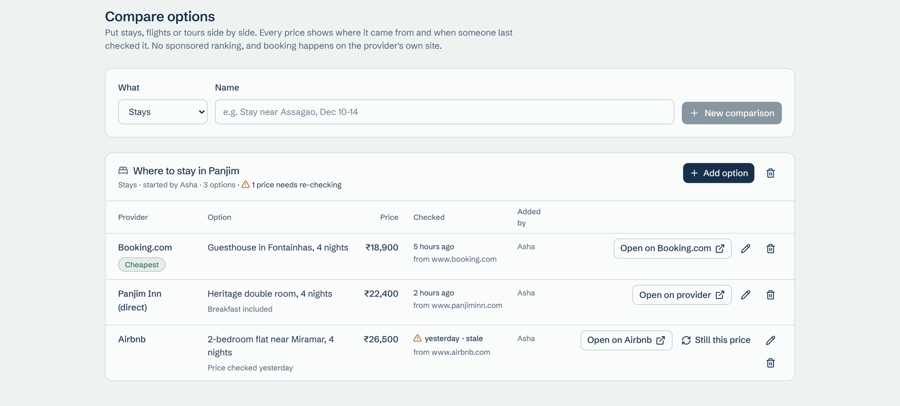
</p>

## AI that shows its work

Meridian runs a **small local model** (default `qwen3:4b-instruct-2507` through Ollama), so your group's preferences are never sent to an AI provider. Any OpenAI-compatible host works by changing three environment variables.

The rule is simple: **code computes, the model phrases and picks.** The model only chooses from IDs it is given, every answer is checked against a schema and the real numbers, and every feature has a rule-based fallback.

| | What the model does | What code does | If the model fails or is off |
|---|---|---|---|
| **A1 Travel-style profile** | Reads "describe your ideal trip" | Builds the profile from the quiz; keeps only interests the text supports | Profile from the quiz alone |
| **A2 Suggestions** | Re-ranks the top 10 and writes "why this fits" | Retrieves candidates; scores fit and the anti-tourist-trap weighting | Rule ranking and template reasons |
| **A3 Group trade-offs** | Phrases agreements and conflicts | Computes every overlap, gap and range | Template sentences |
| **A4 Draft itinerary** | Orders and times one day per call | Clusters days, checks travel times, meal times and day length; repairs what's wrong | Rule-based day plan |
| **A6 Decision summary** | Writes the log entry | Supplies the facts; rejects any summary whose numbers don't match | Template summary |

AI runs as background jobs with live progress and a cancel button, so the app never waits on the model. Results are cached per input, and every call is logged with its prompt version, tokens, latency and validation result. The full design and benchmark results are in [`docs/AI_DESIGN.md`](docs/AI_DESIGN.md).

## Try it in five minutes

You need Docker and Node 22+. [Ollama](https://ollama.com) is optional: without it, every AI feature falls back to rules.

```bash
cp .env.example .env                 # optional; compose has working defaults
ollama pull qwen3:4b-instruct-2507   # optional
docker compose up --build
node scripts/seed.mjs                # a ready-made demo trip, with AI results cached
```

Open **http://localhost:3000** and sign in with one of the demo travelers (the password for all four is `meridian-demo`):

| Account | Travel style |
|---|---|
| `asha@meridian.demo` | Organizer · balanced pace · mid budget · heritage and food |
| `meera@meridian.demo` | Slow pace · budget · vegetarian · avoids crowds |
| `dev@meridian.demo` | Packed days · splurge · adventure and nightlife |
| `kabir@meridian.demo` | Balanced · photography, forts, local life |

The seed creates **"Goa with friends"**, a five-day trip starting 30 days from today, with:
- 16 shortlisted places from OpenStreetMap, with reasons and reactions;
- a stay comparison where one price is stale;
- cached trade-offs, suggestions and a draft itinerary;
- one decided change in the log, and one open proposal waiting for votes.

`node scripts/seed.mjs --reset` starts it over.

<details>
<summary><b>Guided demo (about 10 minutes)</b></summary>

<br>

1. Sign up and create a trip. Open its invite link in a **private window or a second browser** (logins are per browser), join, and take the quiz to watch the AI build a profile live.
2. Switch to **Goa with friends** as Asha. Walk through the **Shortlist** (list and map), **Group fit** and **Suggestions**, moving the hidden-gems slider.
3. Open the **Itinerary**. The cached draft loads instantly; "Regenerate draft" shows the AI job's progress.
4. With Asha in one window and Dev in the other, approve the open proposal. It applies at 3 of 4, live in both windows.
5. Approve the plan in both windows. At 3 of 4, **Lock itinerary** opens for Asha. Lock it.
6. Open **Decisions** to see the new entries with their AI summaries.

</details>

## Architecture

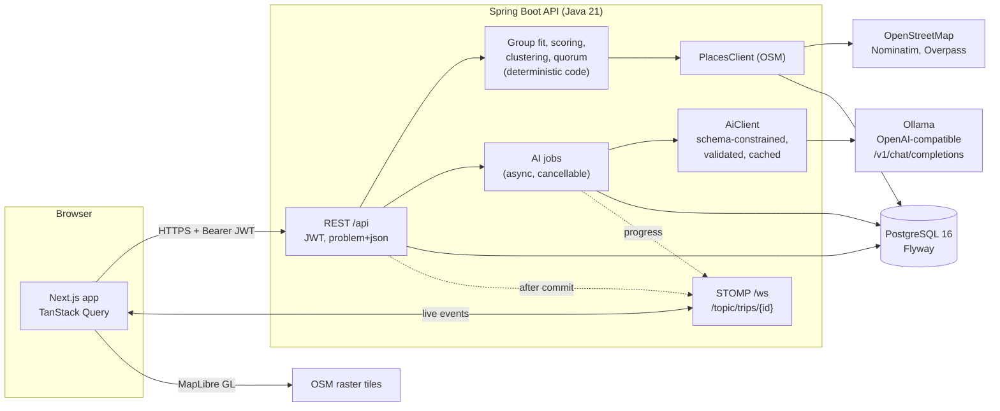

- **Deterministic first.** Fit scores, the anti-tourist-trap weighting, day clustering, travel times, vote counting and the consensus gate are all plain, tested code.
- **Live by default.** After every committed change the API publishes an event to the trip's topic, and each open window refetches what changed. Only trip members can subscribe.
- **Trustworthy records.** The decision log is append-only, enforced by the database itself. Votes and locks take a row lock, so two windows can't race each other.

| Layer | Built with |
|---|---|
| Frontend | Next.js 15 (App Router), React 19, TypeScript, Tailwind CSS 4, shadcn/ui, TanStack Query, MapLibre GL, STOMP.js |
| Backend | Java 21, Spring Boot 3.5 (Web, Security with JWT, Data JPA, WebSocket), Flyway |
| Data | PostgreSQL 16; OpenStreetMap places cached in the database |
| AI | Ollama, or any OpenAI-compatible endpoint, behind a single `AiClient` |
| Infra | Docker Compose |

## Configuration

Copy `.env.example` to `.env` and change what you need. Every variable has a working default.

| Variable | Default | Purpose |
|---|---|---|
| `DATABASE_URL` | `jdbc:postgresql://localhost:5432/meridian` | JDBC URL (compose sets it for the container) |
| `DATABASE_USERNAME` / `DATABASE_PASSWORD` | `meridian` / `meridian` | Database login |
| `POSTGRES_DB` / `POSTGRES_USER` / `POSTGRES_PASSWORD` | `meridian` | The compose Postgres container |
| `JWT_SECRET` | dev-only value | HMAC key for tokens, at least 32 bytes |
| `AI_ENABLED` | `true` | `false` turns every AI feature into its rule-based fallback |
| `AI_BASE_URL` | `http://localhost:11434/v1` | OpenAI-compatible endpoint when the backend runs on the host |
| `AI_BASE_URL_DOCKER` | `http://host.docker.internal:11434/v1` | The same endpoint as seen from the backend container |
| `AI_API_KEY` | `ollama` | Any string for Ollama; a real key for hosted providers |
| `AI_MODEL` | `qwen3:4b-instruct-2507` | Model name on that endpoint |
| `AI_MAX_CONCURRENCY` | `1` | Model calls at a time |
| `AI_TIMEOUT_SECONDS` | `90` | Per call; on timeout the rule-based result is used |
| `PLACES_PROVIDER` | `osm` | Places implementation |
| `OVERPASS_URL` | `https://overpass-api.de/api/interpreter` | Comma-separated mirrors, tried in order |
| `NOMINATIM_URL` | `https://nominatim.openstreetmap.org` | Search and geocoding (can be self-hosted) |
| `APP_BASE_URL` | `http://localhost:3000` | Invite links, CORS and the WebSocket origin |
| `NEXT_PUBLIC_API_URL` | `http://localhost:8080` | Where the browser reaches the API and `/ws`; baked in at frontend build time |

### Running without AI

Set `AI_ENABLED=false` and restart the backend (`docker compose up -d backend`), or just leave Ollama stopped. Every feature keeps working, and every number, ranking, day plan and vote stays the same:

- profiles come from the quiz answers alone;
- suggestions keep the rule ranking, with template "why this fits" sentences;
- trade-offs, day summaries and decision summaries come from templates;
- the itinerary uses the rule plan (nearest-neighbour route, meals at lunch and dinner).

Each output's badge reads **Rules** instead of **AI**, and its "Why?" popover says so.

## Development

You need JDK 21, Maven 3.9+, Node 22+, and Docker (for Postgres and the integration tests).

```bash
docker compose up -d postgres
mvn -f backend spring-boot:run          # API on :8080
npm --prefix frontend install
npm --prefix frontend run dev           # UI on :3000
```

```bash
mvn -f backend verify                   # unit + Testcontainers integration tests
npm --prefix frontend run lint
scripts/ai-benchmark                    # tokens/sec and JSON validity of the configured model
```

The backend tests cover the group-fit math, the anti-tourist-trap scorer, quorum and vote outcomes, clustering and scheduling, validation of every AI output, WebSocket authorization, and the full API flows (with AI off and OpenStreetMap faked).

```
backend/    Spring Boot API (Java 21, Flyway, JWT, STOMP)
frontend/   Next.js App Router + Tailwind + shadcn/ui + TanStack Query
docs/       AI_DESIGN.md, logo and screenshots
scripts/    seed (demo data) + ai-benchmark (model speed and JSON validity)
```

<br>

<div align="center">
  <br>
  <sub><b>Meridian</b> · plan one trip, together · map data © OpenStreetMap contributors</sub>
</div>
