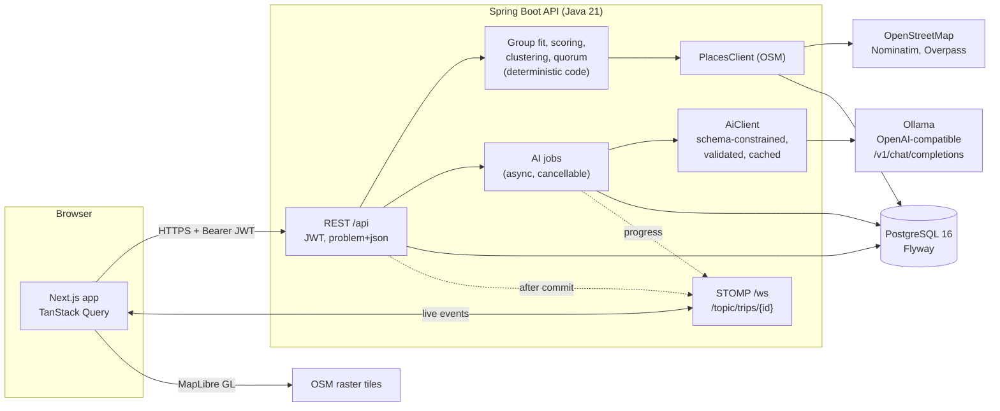

# Meridian

AI-powered collaborative trip planning. A group plans one trip in a shared space; an AI learns each traveler's style, reconciles the group's preferences and proposes ad-free, non-touristy itineraries that the group votes on and edits.

Each traveler takes a short quiz, and the AI turns it into a travel-style profile they can edit. The group builds a shortlist of OpenStreetMap places, sees where its preferences agree and conflict, gets suggestions ranked for the whole group (never by paid placement), compares prices with their source and checked-at time, and gets a draft day-by-day itinerary. Members propose changes and vote on them live. The plan can be locked only when the quorum approves it, and every decision goes in an append-only log with an AI-written summary. Nothing is booked: every option links out to its provider.

## Architecture



- **Deterministic first.** Fit scores, the anti-tourist-trap weighting, day clustering, travel times, vote counting and the consensus gate are plain code. The model reads free text (A1), re-ranks and explains (A2), phrases trade-offs (A3), orders one day at a time (A4) and writes decision summaries (A6). It only picks from ids it is given, and every answer is validated, repaired or replaced by a template. See [`docs/AI_DESIGN.md`](docs/AI_DESIGN.md).
- **Live.** After every committed change the API publishes an event to the trip's topic. The frontend refetches what changed, so votes, proposals, the plan, decisions, comments, the shortlist and AI-job progress update in every open window.

## Run with Docker

Requirements: Docker; [Ollama](https://ollama.com) on the host for AI (optional).

```bash
cp .env.example .env              # optional; compose has working defaults
ollama pull qwen3:4b-instruct-2507  # optional: without it every AI feature falls back to rules
docker compose up --build
node scripts/seed.mjs             # demo trip with cached AI results (needs Node 22+)
```

- App: http://localhost:3000
- API health: http://localhost:8080/api/health

## Run locally (dev)

Requirements: JDK 21, Maven 3.9+, Node 22+, Docker (for Postgres and the tests).

```bash
docker compose up -d postgres
mvn -f backend spring-boot:run          # API on :8080
npm --prefix frontend install
npm --prefix frontend run dev           # UI on :3000
```

## Demo data

`scripts/seed` (or `node scripts/seed.mjs`) creates, through the API:

- four travelers with clearly different styles: Asha (organizer, balanced, mid budget, heritage and food), Meera (slow, budget, vegetarian, avoids crowds), Dev (packed, splurge, adventure and nightlife) and Kabir (balanced, photography, forts and local life). Everyone's password is `meridian-demo`, e.g. `asha@meridian.demo`.
- a 5-day Goa trip starting 30 days from today, with private budgets, 16 shortlisted places from OpenStreetMap with reasons and reactions, and a stay comparison (one price stale);
- cached AI results: the group trade-offs, suggestions for sights, food and activities, and the draft itinerary, so they load instantly in the demo;
- one decided change in the decision log, two plan approvals, and one open proposal (Meera for, Kabir against) to decide live.

It is safe to rerun: it stops if the demo trip already exists. `node scripts/seed.mjs --reset` deletes the demo trip through `docker compose exec postgres` and seeds it again. With Ollama running, the seed takes a few minutes, since each AI result is computed once.

**Demo walk-through:** sign up and create a trip, then open its invite link in a second window and take the quiz there (live AI profile). Switch to the seeded trip and walk through the Shortlist (with the map), Group fit, Suggestions, the Itinerary and Decisions. Sign in as Asha and Dev in two windows and approve the open proposal; it applies at 3 of 4. Then approve the plan in both windows; at 3 of 4 the Lock button opens for Asha. Lock it, and read the new entry in Decisions.

## Environment variables

| Variable | Default | Purpose |
|---|---|---|
| `DATABASE_URL` | `jdbc:postgresql://localhost:5432/meridian` | JDBC URL (compose sets it for the container) |
| `DATABASE_USERNAME` / `DATABASE_PASSWORD` | `meridian` / `meridian` | Database login |
| `POSTGRES_DB` / `POSTGRES_USER` / `POSTGRES_PASSWORD` | `meridian` | The compose Postgres container |
| `JWT_SECRET` | dev-only value | HMAC key for tokens, at least 32 bytes |
| `AI_ENABLED` | `true` | `false` turns every AI feature into its rule-based fallback |
| `AI_BASE_URL` | `http://localhost:11434/v1` | OpenAI-compatible endpoint (Ollama) when the backend runs on the host |
| `AI_BASE_URL_DOCKER` | `http://host.docker.internal:11434/v1` | The same endpoint as seen from the backend container |
| `AI_API_KEY` | `ollama` | Any string for Ollama; a real key for hosted providers |
| `AI_MODEL` | `qwen3:4b-instruct-2507` | Model name on that endpoint |
| `AI_MAX_CONCURRENCY` | `1` | Model calls at a time |
| `AI_TIMEOUT_SECONDS` | `90` | Per call; on timeout the rule-based result is used |
| `PLACES_PROVIDER` | `osm` | Places implementation |
| `OVERPASS_URL` | `https://overpass-api.de/api/interpreter` | Comma-separated mirrors, tried in order |
| `NOMINATIM_URL` | `https://nominatim.openstreetmap.org` | Search and geocoding (can be self-hosted) |
| `APP_BASE_URL` | `http://localhost:3000` | Invite links, CORS and the WebSocket origin |
| `NEXT_PUBLIC_API_URL` | `http://localhost:8080` | Where the browser reaches the API (and `/ws`); baked in at frontend build time |

## Running without AI

Set `AI_ENABLED=false` in `.env` and restart (`docker compose up -d backend`), or just leave Ollama stopped. Every feature still works and every number, ranking, day plan and vote is identical:

- profiles come from the quiz answers alone (the free-text answer is not read);
- suggestions keep the rule ranking with template "why this fits" sentences;
- trade-offs, day summaries and decision summaries are written from templates;
- the itinerary uses the rule plan (nearest-neighbour route, meals at lunch and dinner).

Every output shows an **AI** or **Rules** badge, and its "Why?" popover says how it was made.

## Features

- **Profiles (A1).** Sliders, choices and a free-text "ideal trip" become a structured profile that the traveler can see and edit. The model only adds interests it can quote from the text.
- **Shortlist.** Add places by OpenStreetMap search, by pasting a link (only its title is read, server-side, behind an SSRF guard) or with a map pin. Each item shows who added it and why. Members react love / ok / no-way. List and map views.
- **Group fit.** A members × preferences matrix with agreements, trade-offs and conflicts (icon, word and colour), AI-phrased trade-offs (A3), a fit score per place with who it suits and why, and who hasn't filled in preferences. Budgets stay private; the group sees only a shared range.
- **Suggestions (A2).** Places ranked for the group with a hidden-gems ↔ classics slider and an avoid-crowds toggle. The AI re-ranks the top ten and writes "why this fits". No commercial signal exists in ranking.
- **Compare.** Prices with provider, currency, checked-at time (stale after 24 h), source link and a Sponsored label when a member marks one. Booking always happens on the provider's site.
- **Itinerary (A4).** Days grouped by area at the group's pace, travel times, AI order and timing one day at a time with visible repairs, a route map per day, organizer edits and member proposals, and comments.
- **Voting and consensus.** Approve or reject proposals with equal votes; approved changes apply automatically, live in every window. Members approve the plan; "Lock itinerary" opens only at quorum and shows who hasn't voted. The organizer can override only with a logged reason. The organizer sets the quorum in Members (majority by default).
- **Decision log (A6).** Append-only entries with the alternatives, votes, who didn't vote, the reason and an AI summary that can be regenerated or dismissed. Itinerary stops link to the decision that put them there.

## Tests

```bash
mvn -f backend verify        # unit + Testcontainers integration tests (needs Docker)
npm --prefix frontend run lint
```

Backend tests cover the group-fit math, the anti-tourist-trap scorer, the quorum rule and vote outcomes, clustering and scheduling, A1–A6 output validation, the WebSocket authorization and the full flows through the API (AI off, OpenStreetMap faked).

## Layout

```
backend/    Spring Boot API (Java 21, Flyway, JWT, STOMP)
frontend/   Next.js App Router + Tailwind + shadcn/ui + TanStack Query
docs/       AI_DESIGN.md
scripts/    seed (demo data) + ai-benchmark (model speed and JSON validity)
```
